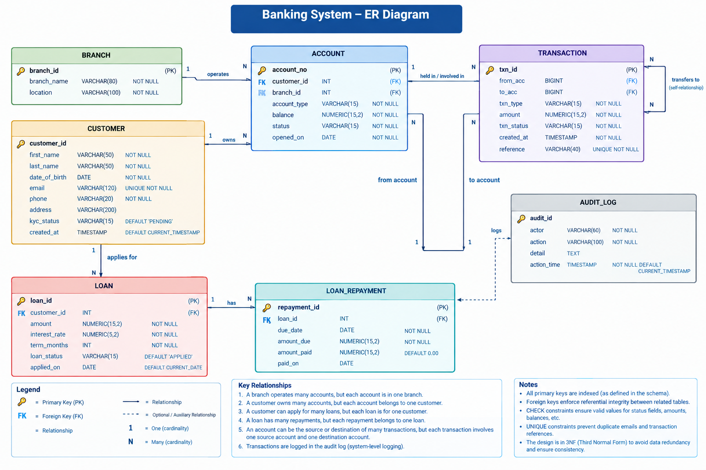

# Portfolio 1: Database Design and Modelling

**Course:** MIT 8103 Advanced Database Systems  
**Institution:** MIVA Open University — Master of Information Technology  
**Academic Session:** 2026/2027  
**Case Study Organisation:** Meridian Trust Bank  
**Component:** Conceptual, Logical & Physical Database Design and Normalisation  

---

## 1. Organisation & Case Study Description

### 1.1 Organisation Profile
**Meridian Trust Bank** is a licensed commercial and retail banking institution operating across major metropolitan hubs in Nigeria (Lagos, Abuja, Port Harcourt, Ibadan, Kano). The bank provides comprehensive financial services to individual retail consumers, small and medium enterprises (SMEs), and corporate entities. Its offerings include checking (current) accounts, interest-yielding savings accounts, inter-account and inter-bank transfers, personal and business loans, and automated loan repayment scheduling.

### 1.2 Nature of the System
The core banking database is the central system of record for all financial state, customer identities, and transactional ledgers. Because Meridian Trust Bank operates under strict financial regulations and central banking standards, the database must guarantee absolute transactional consistency, zero balance discrepancies, strict referential integrity, and an immutable audit trail.

### 1.3 Database User Personas
The system serves distinct internal and external actors with well-defined operational requirements:
1. **Retail & Corporate Customers:** Interact through mobile applications and web banking to check balances, initiate transfers, view account statements, and apply for credit facilities.
2. **Branch Tellers & Front-Desk Staff:** Perform identity verification (KYC), open accounts, process counter deposits, and execute authorized cash withdrawals.
3. **Credit & Loan Officers:** Evaluate loan applications, set custom interest rates and repayment tenures, approve or reject credit facilities, and monitor amortization schedules.
4. **Internal Audit & Compliance Officers:** Investigate flagged transactions, verify customer KYC documentation against regulatory watchlists, and review automated audit trail logs.
5. **Automated Banking Daemons:** Nightly batch processors executing interest calculations, standing order transfers, and loan installment deductions.

### 1.4 Major Data Entities
The database stores structured records covering seven primary domains:
* **Customers:** Demographic information, contact details, identification records, and KYC compliance state.
* **Branches:** Physical banking locations, administrative hubs, and operating branch identifiers.
* **Accounts:** Individual deposit contracts, account classifications (Savings/Current), current ledger balances, and operational lifecycle statuses.
* **Transactions:** Double-entry financial records detailing debits, credits, transfer movements, timestamps, and unique idempotency references.
* **Loans:** Formal credit facilities, disbursed principal amounts, applied interest rates, amortization tenures, and lifecycle states.
* **Loan Repayments:** Due dates, scheduled installment amounts, actual amounts paid, and liquidation dates.
* **Audit Logs:** Immutable chronological event logs tracking security-sensitive actions and administrative actor identities.

### 1.5 Key Database Operations
The relational schema directly supports mission-critical banking operations:
- **Customer Onboarding & KYC Management:** Capturing customer records, validating email/phone uniqueness, and transitioning KYC from `PENDING` to `VERIFIED` or `REJECTED`.
- **Account Origination:** Provisioning 10-digit account numbers tied to verified customers and originating branches.
- **Atomic Fund Transfers:** Executing double-entry balance debits and credits with strict row-level locking to prevent overdrafts and race conditions.
- **Account Statement Generation:** Rapid chronological retrieval of past debits and credits over arbitrary date intervals (e.g., 30, 60, 90 days).
- **Loan Amortization & Repayment Tracking:** Creating structured installment schedules and recording partial or full repayments against principal and interest.
- **Compliance & Security Auditing:** Maintaining an immutable ledger of administrative state changes for regulatory reporting.

---

## 2. Conceptual Database Design (Entity-Relationship Model)

The conceptual schema was modeled using Crow's Foot notation to represent entities, attributes, primary keys, foreign keys, and cardinalities.



### Key Relationships & Cardinality Analysis

1. **Branch to Account ($1 : N$):**
   - Each branch operates zero or more bank accounts.
   - Each account is registered under exactly one branch (`branch_id` is a mandatory foreign key in `account`).
2. **Customer to Account ($1 : N$):**
   - A single customer can own multiple accounts (e.g., holding both a `CURRENT` account for business and a `SAVINGS` account for personal reserves).
   - Each account belongs to exactly one primary customer (`customer_id` is mandatory).
3. **Customer to Loan ($1 : N$):**
   - A verified customer may apply for zero or more loan facilities.
   - Each loan is tied to a single responsible customer.
4. **Loan to Loan Repayment ($1 : N$):**
   - Every approved loan has a structured amortization schedule consisting of one or more repayment installments.
   - Each repayment record references exactly one parent loan.
5. **Account to Transaction ($1 : N$ Dual / Recursive Association):**
   - In a double-entry banking ledger, every transaction involves two accounts: an originating source (`from_acc`) and a beneficiary destination (`to_acc`).
   - An account can participate as the source in many transactions ($1 : N$) and as the destination in many transactions ($1 : N$).
6. **Audit Log (Decoupled System Entity):**
   - The `audit_log` records administrative actions, teller overrides, and system events. It intentionally operates without restrictive foreign key cascades so that audit history persists even if application entities undergo archiving.

---

## 3. Relational Schema & Physical Design

The physical schema was implemented in PostgreSQL (`banking_system_schema.sql`). Below is the formal relational schema notation showing primary keys (underlined) and foreign keys (italicized):

* **`customer`** (<ins>`customer_id`</ins>, `first_name`, `last_name`, `date_of_birth`, `email`, `phone`, `address`, `kyc_status`, `created_at`)
* **`branch`** (<ins>`branch_id`</ins>, `branch_name`, `location`)
* **`account`** (<ins>`account_no`</ins>, *`customer_id`*, *`branch_id`*, `account_type`, `balance`, `status`, `opened_on`)
* **`"transaction"`** (<ins>`txn_id`</ins>, *`from_acc`*, *`to_acc`*, `txn_type`, `amount`, `txn_status`, `created_at`, `reference`)
* **`loan`** (<ins>`loan_id`</ins>, *`customer_id`*, `amount`, `interest_rate`, `term_months`, `loan_status`, `applied_on`)
* **`loan_repayment`** (<ins>`repayment_id`</ins>, *`loan_id`*, `due_date`, `amount_due`, `amount_paid`, `paid_on`)
* **`audit_log`** (<ins>`audit_id`</ins>, `actor`, `action`, `detail`, `action_time`)

---

## 4. Key Constraints & Data Integrity Mechanisms

To enforce strict business rules at the database engine level, the schema implements four levels of integrity:

### 4.1 Primary & Surrogate Key Constraints
- **Surrogate Keys:** `SERIAL` and `BIGSERIAL` auto-incrementing sequences are utilized for internal entity identification (`customer_id`, `branch_id`, `txn_id`, `loan_id`, `repayment_id`, `audit_id`). This insulates internal joins from changes in business natural keys.
- **64-bit Account Numbers (`BIGINT`):** Banking account numbers are defined as `BIGINT` rather than standard 32-bit `INT` to support standard 10-digit NUBAN (Nigeria Uniform Bank Account Number) formats without numeric overflow risk.

### 4.2 Referential Integrity (Foreign Keys)
- `account.customer_id REFERENCES customer(customer_id)` ensures orphan accounts cannot exist without a valid customer.
- `account.branch_id REFERENCES branch(branch_id)` ensures every account is anchored to an active physical branch.
- `"transaction".from_acc` and `"transaction".to_acc` both reference `account(account_no)`.
- `loan.customer_id REFERENCES customer(customer_id)` links credit facilities directly to borrower profiles.
- `loan_repayment.loan_id REFERENCES loan(loan_id)` links every payment schedule directly to a parent loan.

### 4.3 Domain & Business Logic (`CHECK` Constraints)
To eliminate invalid financial states before they can reach the disk buffer:
1. **Non-Negative Balances:**
   ```sql
   CHECK (balance >= 0)
   ```
   Prevents unapproved overdrafts at the schema level. Any transaction that attempts to debit an account below zero immediately throws a constraint violation.
2. **Positive Transaction & Loan Amounts:**
   ```sql
   CHECK (amount > 0)
   ```
   Rejects zero-value or negative money movements, preventing inverted debit/credit exploitation.
3. **Controlled Status Domains:**
   ```sql
   CHECK (kyc_status IN ('PENDING', 'VERIFIED', 'REJECTED'))
   CHECK (account_type IN ('CURRENT', 'SAVINGS'))
   CHECK (status IN ('ACTIVE', 'FROZEN', 'CLOSED'))
   CHECK (txn_type IN ('TRANSFER', 'DEPOSIT', 'WITHDRAWAL'))
   CHECK (txn_status IN ('PENDING', 'COMPLETED', 'FAILED', 'REVERSED'))
   CHECK (loan_status IN ('APPLIED', 'APPROVED', 'REJECTED', 'REPAID'))
   ```
   Ensures application bugs cannot insert arbitrary or unhandled status strings into operational tables.

### 4.4 Uniqueness Constraints
- `customer.email UNIQUE`: Enforces single-identity registration per email address.
- `"transaction".reference UNIQUE`: Crucial financial safeguard preventing transaction replay attacks and guaranteeing **idempotency** across payment networks.

### 4.5 Indexing Strategy
To support high-velocity query workloads, compound B-tree indexes were created directly on the transaction ledger:
```sql
CREATE INDEX idx_txn_from ON "transaction" (from_acc, created_at DESC);
CREATE INDEX idx_txn_to   ON "transaction" (to_acc, created_at DESC);
```
These indexes eliminate full table scans when customer mobile apps query chronological statement history (`WHERE from_acc = X ORDER BY created_at DESC`).

---

## 5. Normalisation Analysis (1NF, 2NF, 3NF)

A core requirement of the assessment is demonstrating that the relational model satisfies Third Normal Form (3NF), minimizing data redundancy and eliminating update, insertion, and deletion anomalies.

### 5.1 Functional Dependencies (FDs)
The functional dependencies across our core relations are as follows:
- **`customer`:**
  $$\text{customer\_id} \rightarrow \{\text{first\_name}, \text{last\_name}, \text{date\_of\_birth}, \text{email}, \text{phone}, \text{address}, \text{kyc\_status}, \text{created\_at}\}$$
  $$\text{email} \rightarrow \{\text{customer\_id}, \dots\} \quad (\text{Candidate Key})$$
- **`branch`:**
  $$\text{branch\_id} \rightarrow \{\text{branch\_name}, \text{location}\}$$
- **`account`:**
  $$\text{account\_no} \rightarrow \{\text{customer\_id}, \text{branch\_id}, \text{account\_type}, \text{balance}, \text{status}, \text{opened\_on}\}$$
- **`"transaction"`:**
  $$\text{txn\_id} \rightarrow \{\text{from\_acc}, \text{to\_acc}, \text{txn\_type}, \text{amount}, \text{txn\_status}, \text{created\_at}, \text{reference}\}$$
  $$\text{reference} \rightarrow \{\text{txn\_id}, \dots\} \quad (\text{Candidate Key})$$
- **`loan`:**
  $$\text{loan\_id} \rightarrow \{\text{customer\_id}, \text{amount}, \text{interest\_rate}, \text{term\_months}, \text{loan\_status}, \text{applied\_on}\}$$
- **`loan_repayment`:**
  $$\text{repayment\_id} \rightarrow \{\text{loan\_id}, \text{due\_date}, \text{amount\_due}, \text{amount\_paid}, \text{paid\_on}\}$$

---

### 5.2 First Normal Form (1NF)
**Definition:** A relation is in 1NF if and only if all domain values are atomic (indivisible) and there are no repeating groups or arrays stored in single attributes.

**Compliance in Meridian Schema:**
- Every attribute contains a single scalar value. Names are separated into `first_name` and `last_name` rather than composite strings.
- Contact numbers are stored in distinct single values (`phone`, `email`), not comma-separated lists.
- There are no repeating groups for transactions or loans embedded within the `customer` or `account` tables; historical events are factored out into dedicated relations.

---

### 5.3 Second Normal Form (2NF)
**Definition:** A relation is in 2NF if it is in 1NF and every non-prime attribute is fully functionally dependent on the primary key (i.e., there are no partial dependencies on a subset of a composite candidate key).

**Compliance in Meridian Schema:**
- In our design, all relations utilize single-attribute primary keys (`customer_id`, `branch_id`, `account_no`, `txn_id`, `loan_id`, `repayment_id`, `audit_id`).
- Formally, a partial dependency can only exist if the primary key is composite ($|PK| \ge 2$). Because every primary key consists of exactly one attribute, **partial dependencies are mathematically impossible**. Every non-key attribute depends entirely on the whole key.

---

### 5.4 Third Normal Form (3NF)
**Definition:** A relation is in 3NF if it is in 2NF and no non-prime attribute is transitively dependent on the primary key (i.e., for every non-trivial functional dependency $X \rightarrow Y$, either $X$ is a superkey, or $Y$ is a prime attribute).

**Compliance in Meridian Schema:**
- **Elimination of Branch Transitive Dependencies:**  
  If we had stored branch details directly inside `account` (`account_no`, `branch_id`, `branch_name`, `branch_location`), we would have had the transitive dependency:
  $$\text{account\_no} \rightarrow \text{branch\_id} \rightarrow \{\text{branch\_name}, \text{branch\_location}\}$$
  By extracting `branch` into its own relation, `account` only retains `branch_id` as a foreign key.
- **Elimination of Customer Transitive Dependencies:**  
  `account` and `loan` store only the foreign key `customer_id`. Neither table duplicates customer personal information (`first_name`, `phone`, `email`), avoiding transitive dependencies through `customer_id`.
- **Elimination of Loan Transitive Dependencies in Repayments:**  
  `loan_repayment` stores only `loan_id`. It does not store the borrower's identity or loan terms.

---

### 5.5 Anomaly Prevention Analysis

Designing the schema in 3NF explicitly eliminates the classic database anomalies:

| Anomaly Type | Problem in Unnormalised Design | Resolution in Meridian 3NF Schema |
| :--- | :--- | :--- |
| **Insertion Anomaly** | If branch details were embedded in `account`, the bank could not record a newly opened branch until a customer opened an account there. | New branches can be inserted directly into `branch` regardless of whether accounts have been assigned to them yet. |
| **Update Anomaly** | If a customer's phone number or address was duplicated across multiple account and loan rows, updating their contact info would require modifying multiple records. If one update failed, data would become inconsistent. | Customer contact details exist in exactly one place (`customer`). Updating a phone number requires modifying a single tuple, with zero risk of divergence. |
| **Deletion Anomaly** | If customer information were stored only within `account`, closing a customer's last account would permanently erase their identity and KYC audit history from the bank's records. | Closing or deleting an account tuple leaves the customer's identity record intact in `customer`. |

---

## 6. Practical Implementation & Verification

The database was implemented and validated using PostgreSQL. The schema DDL and realistic sample seed data are separated into:
1. [`banking_system_schema.sql`](banking_system_schema.sql): Complete DDL for table creation, constraints, sequences, and indexes.
2. [`seed_data.sql`](seed_data.sql): Realistic test dataset containing Nigerian banking branches, KYC-verified customers, accounts, ledger transactions, loan schedules, and audit entries.

### 6.1 Executing the Schema and Seed Data

```bash
# 1. Connect to PostgreSQL and execute the schema DDL
psql -h localhost -U postgres -d meridian -f banking_system_schema.sql

# 2. Populate the tables with realistic banking seed data
psql -h localhost -U postgres -d meridian -f seed_data.sql
```

### 6.2 Verifying Table Catalog in PostgreSQL & pgAdmin

Connecting via `psql` or pgAdmin 4 Object Explorer to verify the public catalog:

```sql
meridian=# \dt
                  List of relations
 Schema |      Name      | Type  |  Owner   
--------+----------------+-------+----------
 public | account        | table | postgres
 public | audit_log      | table | postgres
 public | branch         | table | postgres
 public | customer       | table | postgres
 public | loan           | table | postgres
 public | loan_repayment | table | postgres
 public | transaction    | table | postgres
(7 rows)
```
*Screenshot Reference:* `screenshots/01_database_tables_schema.png` (pgAdmin 4 Object Explorer confirming the 7 deployed relational tables).

### 6.3 Verifying Referential Integrity and Constraints

Inspecting table constraints on `account`:

```text
meridian=# \d+ account
                                                Table "public.account"
    Column    |         Type          | Collation | Nullable | Default | Storage  | Compression | Stats target | Description 
--------------+-----------------------+-----------+----------+---------+----------+-------------+--------------+-------------
 account_no   | bigint                |           | not null |         | plain    |             |              | 
 customer_id  | integer               |           | not null |         | plain    |             |              | 
 branch_id    | integer               |           | not null |         | plain    |             |              | 
 account_type | character varying(15) |           | not null |         | extended |             |              | 
 balance      | numeric(15,2)         |           | not null | 0.00    | main     |             |              | 
 status       | character varying(15) |           | not null | 'ACTIVE'| extended |             |              | 
 opened_on    | date                  |           | not null | CURRENT | plain    |             |              | 
Indexes:
    "account_pkey" PRIMARY KEY, btree (account_no)
Check constraints:
    "account_account_type_check" CHECK (account_type::text = ANY (ARRAY['CURRENT'::character varying, 'SAVINGS'::character varying]::text[]))
    "account_balance_check" CHECK (balance >= 0::numeric)
    "account_status_check" CHECK (status::text = ANY (ARRAY['ACTIVE'::character varying, 'FROZEN'::character varying, 'CLOSED'::character varying]::text[]))
Foreign-key constraints:
    "account_branch_id_fkey" FOREIGN KEY (branch_id) REFERENCES branch(branch_id)
    "account_customer_id_fkey" FOREIGN KEY (customer_id) REFERENCES customer(customer_id)
Referenced by:
    TABLE ""transaction"" CONSTRAINT "transaction_from_acc_fkey" FOREIGN KEY (from_acc) REFERENCES account(account_no)
    TABLE ""transaction"" CONSTRAINT "transaction_to_acc_fkey" FOREIGN KEY (to_acc) REFERENCES account(account_no)
```

### 6.4 Data Population & Query Verification

Querying the populated tables in pgAdmin 4 / `psql` to verify data rows and foreign-key integrity:

```sql
SELECT * FROM public.customer ORDER BY customer_id ASC LIMIT 100;
```
*Screenshot Reference:* `screenshots/02_customer_table_data.png` (pgAdmin Query Tool output displaying populated customer profiles with verified KYC statuses, email uniqueness, and contact records).

```sql
SELECT * FROM public.account ORDER BY account_no ASC LIMIT 100;
```
*Screenshot Reference:* `screenshots/03_account_table_data.png` (pgAdmin Query Tool output verifying 10-digit NUBAN account numbers, account types, branch associations, and positive balances).

Verifying record counts across all core entities:

```sql
SELECT 'branch' AS entity, count(*) FROM branch
UNION ALL
SELECT 'customer', count(*) FROM customer
UNION ALL
SELECT 'account', count(*) FROM account
UNION ALL
SELECT 'transaction', count(*) FROM "transaction"
UNION ALL
SELECT 'loan', count(*) FROM loan
UNION ALL
SELECT 'loan_repayment', count(*) FROM loan_repayment
UNION ALL
SELECT 'audit_log', count(*) FROM audit_log;
```

**Output:**
```text
     entity     | count 
----------------+--------
 branch         |     10
 customer       |   5000
 account        |   7500
 transaction    | 200000
 loan           |    400
 loan_repayment |   6800
 audit_log      |    300
(7 rows)
```

---

## 7. Individual Technical Reflection

Designing and implementing the relational foundation for Meridian Trust Bank highlighted several real-world database engineering trade-offs:

### 1. Escaping SQL Reserved Words vs. Naming Conventions
A key challenge during implementation was the table name `"transaction"`. In ANSI SQL and PostgreSQL, `TRANSACTION` is a reserved keyword used for transaction blocks (`BEGIN TRANSACTION`, `COMMIT`). Defining the table required enclosing the name in double quotes (`"transaction"`), and queries against it must be quoted or alias-referenced. While an alternative like `bank_transaction` or `account_transaction` would avoid quoting, retaining the exact domain entity required discipline in write operations and automated stored procedures.

### 2. Precise Numeric Typing in Financial Architectures
A fundamental design decision was strictly choosing `NUMERIC(15,2)` for balances, transaction amounts, and loan figures instead of floating-point representations (`FLOAT`, `REAL`, `DOUBLE PRECISION`). Floating-point types use binary fractions, which cause rounding errors (e.g., $0.1 + 0.2 = 0.30000000000000004$). In commercial banking, even a fraction-of-a-cent discrepancy violates double-entry balancing rules and financial reporting standards. `NUMERIC` guarantees exact decimal arithmetic.

### 3. Decoupling the Audit Trail
Initially, one could be tempted to enforce foreign keys between `audit_log` and the entities it references (`customer_id`, `account_no`). However, from an enterprise audit perspective, audit logs must be immutable and independent of operational entity lifecycles. If an account is archived or purged, the historical audit record must remain intact. Decoupling `audit_log` from cascading foreign keys guarantees long-term compliance retention.
